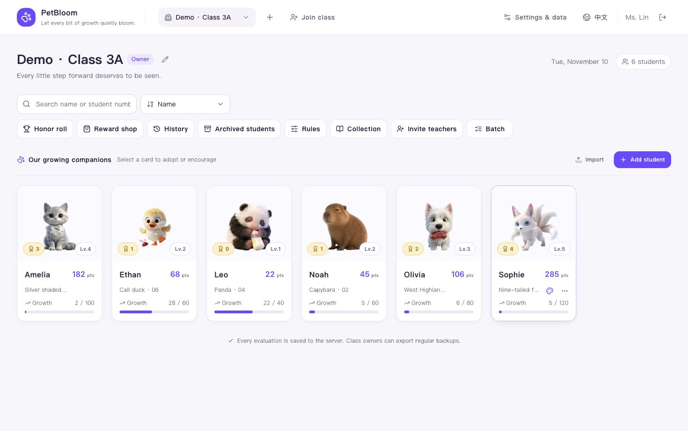
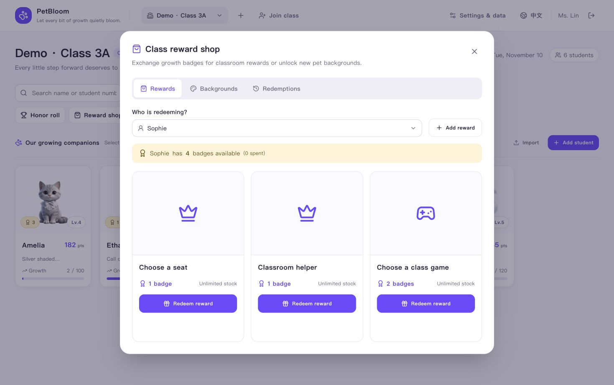

# PetBloom · 萌芽

[中文](README.md) · **English** · [Try online](https://pet.pageon.cc/en) · [Apache-2.0](LICENSE)

> Let every bit of growth quietly bloom.

PetBloom helps teachers encourage student growth through virtual companions. Everyday evaluations earn points, grow pets and unlock badges that students can exchange for classroom rewards. Teachers can manage a class together, with Chinese and English interfaces.

## Screenshots

Actual product screens from local demo classes. All names and scores are sample data.

**Class workspace · Students, companions and growth**



**Reward shop · Exchange growth badges for classroom rewards**



## Features

- **Growing companions**: 50 pets with eight growth stages, adoption, collectible badges and background customization.
- **Everyday feedback**: Built-in rules, custom bonuses and deductions, batch evaluations, an honor roll and reversible scoring history.
- **Shared classes**: Invite teachers to the same class and share students, points and records while preserving each teacher's attribution. Pages refresh every minute and when focus returns.
- **Student management**: Add, edit, import, archive and restore students while preserving their growth history.
- **Classroom rewards**: Custom rewards, inventory, badge redemption and returns, plus everyday and holiday pet backgrounds.
- **Data and platforms**: JSON backup import/export, a responsive bilingual web app and local Windows / macOS desktop builds.

Identical class names do not make classes shared: use an invitation to join the existing class. Desktop builds use a local database and do not automatically sync with the web app or other computers.

## Local development

Requires **Node.js ≥ 22.13** and **pnpm 11**; see `package.json` for the exact package manager version. Local development uses SQLite and needs no cloud service or AI API key.

```bash
git clone https://github.com/anthonyli/pet-bloom.git
cd pet-bloom
pnpm install --frozen-lockfile
pnpm dev
```

Open the [English interface](http://localhost:3100/en) or [Chinese interface](http://localhost:3100/zh). Register and complete your teacher profile, then create a class, join an existing class or choose **Try a demo class**. There is no built-in account or default password.

The default database is `data/pet-garden.db`. To customize configuration, copy [.env.example](.env.example) to `.env.local`. Do not commit databases, sessions or real credentials.

### Commands

| Command | Purpose |
| --- | --- |
| `pnpm dev` | Start development on port 3100 |
| `pnpm typecheck` | Check TypeScript types |
| `pnpm test` | Run automated tests |
| `pnpm build` | Create a production build |
| `pnpm start` | Run the built server, on port 3100 by default |
| `pnpm desktop:dev` | Start the Electron development app |

Use a separate build directory and port when checking a production build alongside the development server:

```bash
BUILD_DIR=.next-build pnpm build
BUILD_DIR=.next-build PORT=3101 pnpm start
```

### Project structure

Built with Next.js App Router, React, TypeScript, Tailwind CSS, Radix UI and SQLite / Turso. The desktop edition uses Electron. Pages and API routes run in one Node.js service.

```text
app/                     Localized pages and API routes
components/              Workspace, pets, scoring, shop and shared UI
lib/server/              Database, permissions, transactions and backups
lib/data/                Pet, rule and background configuration
public/                  Images, SVGs, fonts and provenance records
migrations/turso/        Incremental cloud database migrations
scripts/                 Builds, verification, desktop packaging and releases
tests/                   Domain and API tests
```

Provide Chinese and English text for new features. Validate class access on the server, and use transactions for scoring, undo, redemption and backup restore. See [AGENTS.md](AGENTS.md) for development conventions.

### Deployment and extensions

- [Deployment and data maintenance](docs/deployment.md): Single-server, Docker and Vercel / Turso setups, backups and migrations. Local SQLite requires persistent storage.
- [Desktop development and releases](docs/desktop.md): Windows / macOS packaging, testing and updates.
- [Global admin configuration](docs/admin-classes.md): Server allowlist, All classes and management permissions. The username `admin` does not grant access by itself.

The cloud release scripts target the maintainer's existing project. For a fork, configure `scripts/deploy-config.mjs` and the platform settings for your own project and database before deploying. Follow the checks, backup, migration and release workflow for cloud changes.

## License and image assets

Original project code and documentation are licensed under the **[Apache License 2.0](LICENSE)**. Third-party dependencies, fonts and assets retain their respective terms. The code license does not establish commercial-use or redistribution rights for every image in this repository.

| Asset | Origin and usage notes |
| --- | --- |
| Base pet artwork and egg placeholder | Some were collected online or imported from third parties. Existing records do not provide complete per-asset authorship or permission evidence; do not treat them as original or cleared for commercial use. |
| Rat, ox and snake growth images; level badges | AI-generated, with generation records. Some generation used existing pet artwork as reference. Check the tool terms and rights in reference materials before reuse. |
| Pet background SVGs | Vector scenes created for this project, with a recorded catalog and provenance. |
| Display fonts | Nunito and ZCOOL KuaiLe, each accompanied by its SIL Open Font License. |

When reusing assets, retain their source and license notices. For images with unclear permissions, obtain authorization or replace them with your own or explicitly licensed artwork before public deployment, commercial use or redistribution. **AI generation does not automatically clear all relevant rights.**

See [Asset provenance and usage](ASSETS.md) for scope, records and reporting, and [public/pets/SOURCES.md](public/pets/SOURCES.md) for detailed pet provenance. Rights holders can open a [GitHub issue](https://github.com/anthonyli/pet-bloom/issues) with the file path, original source and ownership information so attribution, replacement or removal can be reviewed.
