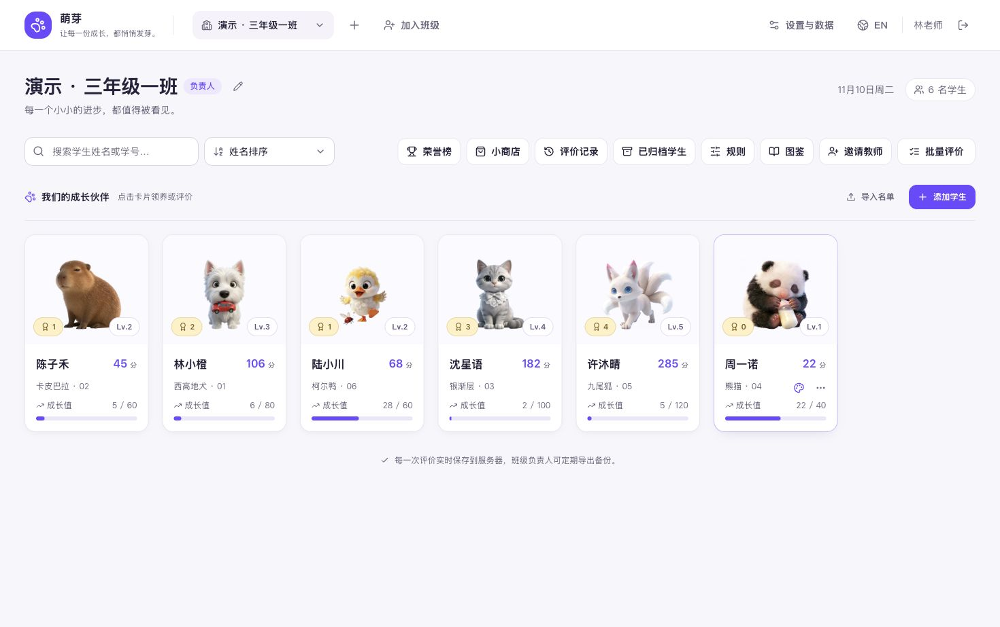

# PetBloom · 萌芽

**中文** · [English](README.en.md) · [在线体验](https://pet.pageon.cc) · [Apache-2.0](LICENSE)

> 让每一份成长，都悄悄发芽。

萌芽是面向学校和班级的学生成长激励工具。老师通过日常评价为学生积累积分，让宠物成长、获得徽章，再用徽章兑换班级奖励。支持多位教师共同管理同一个班级，以及中文、英文界面。

## 产品截图

以下为本地演示班级的真实界面，姓名与评分均为示例数据。

**班级工作台 · 学生、宠物与成长进度**



**奖励商店 · 用成长徽章兑换班级奖励**


## 功能

- **宠物成长**：50 种宠物、8 个成长阶段，支持领养、徽章收藏与背景装扮。
- **日常评价**：内置规则、自定义加减分、批量评价、荣誉榜与可撤回的评分记录。
- **多人共管**：通过邀请码加入同一班级，共享学生、积分和记录，保留每位教师的操作署名。页面每分钟及重新获得焦点时刷新。
- **学生管理**：添加、编辑、批量导入、离班归档与恢复，保留成长历史。
- **班级奖励**：自定义商品、库存、徽章兑换与退回，以及日常和节日宠物背景。
- **数据与平台**：JSON 备份导入导出、响应式双语网页、Windows / macOS 本地桌面版。

同名班级不等于同一班级；协作教师应通过邀请加入已有班级。桌面版使用本机数据库，不会自动与网页版或其他电脑同步。

## 本地开发

需要 **Node.js ≥ 22.13** 和 **pnpm 11**，精确包管理器版本见 `package.json`。本地运行使用 SQLite，无需配置云服务或 AI API Key。

```bash
git clone https://github.com/anthonyli/pet-bloom.git
cd pet-bloom
pnpm install --frozen-lockfile
pnpm dev
```

打开 [中文界面](http://localhost:3100/zh) 或 [英文界面](http://localhost:3100/en)。注册账号并完善教师资料后，可创建班级、加入已有班级，或选择「体验演示班级」。没有内置账号或默认密码。

默认数据库保存在 `data/pet-garden.db`。需要自定义配置时，将 [.env.example](.env.example) 复制为 `.env.local`；不要提交数据库、会话或真实密钥。

### 常用命令

| 命令 | 用途 |
| --- | --- |
| `pnpm dev` | 启动开发服务，端口 3100 |
| `pnpm typecheck` | TypeScript 类型检查 |
| `pnpm test` | 自动化测试 |
| `pnpm build` | 生产构建 |
| `pnpm start` | 启动已构建的服务，默认端口 3100 |
| `pnpm desktop:dev` | 启动 Electron 桌面开发环境 |

开发服务运行时，可使用独立目录进行生产构建与验证，避免覆盖 `.next`：

```bash
BUILD_DIR=.next-build pnpm build
BUILD_DIR=.next-build PORT=3101 pnpm start
```

### 项目结构

技术栈：Next.js App Router、React、TypeScript、Tailwind CSS、Radix UI、SQLite / Turso；桌面版使用 Electron。网页和 API 运行在同一个 Node.js 服务中。

```text
app/                     双语页面与 API 路由
components/              工作台、宠物、评价、商店及共享 UI
lib/server/              数据库、权限、业务事务、备份恢复
lib/data/                宠物、规则与背景配置
public/                  图片、SVG、字体及来源记录
migrations/turso/        云端数据库增量迁移
scripts/                 构建、验证、桌面打包与发布
tests/                  业务与接口测试
```

新增功能需同时提供中英文文案。业务接口必须在服务端验证班级权限；评分、撤回、兑换和备份恢复使用事务。详细约定见 [AGENTS.md](AGENTS.md)。

### 部署与扩展

- [部署与数据维护](docs/deployment.md)：单服务器、Docker、Vercel / Turso、备份与迁移。本地 SQLite 部署需要持久化磁盘。
- [桌面开发与发布](docs/desktop.md)：Windows / macOS 打包、测试和更新发布。
- [全局管理员配置](docs/admin-classes.md)：服务端白名单、全部班级及管理权限；用户名为 `admin` 不会自动获得权限。

仓库中的云发布脚本绑定维护者的现有项目。Fork 后如需云部署，应先将 `scripts/deploy-config.mjs` 和相关平台配置改为自己的项目与数据库；云端变更遵循检查、备份、迁移、发布流程。

## 许可证与图片资源

本项目原创代码与文档采用 **[Apache License 2.0](LICENSE)**。第三方依赖、字体及素材保留各自的许可；代码开源不代表仓库中的所有图片均已获得商业使用或再分发授权。

| 资源 | 来源与使用说明 |
| --- | --- |
| 基础宠物图片、宠物蛋 | 部分从网上收集或第三方导入。现有记录不包含完整的逐项作者与授权证明，不能据此视为原创或已获商用许可。 |
| 鼠、牛、蛇的成长图与等级徽章 | 使用 AI 生成，保留生成记录；部分生成过程参考了现有宠物图。使用时仍需核对工具条款和参考素材权利。 |
| 宠物背景 SVG | 为本项目创作的矢量场景，来源与目录已记录。 |
| 展示字体 | Nunito 和 ZCOOL KuaiLe，分别附有 SIL Open Font License。 |

如果在自己的项目中使用这些资源，请保留对应来源与许可说明；对于授权不明确的图片，在公开部署、商业使用或再次分发前取得授权，或替换为自有／明确获授权的素材。**AI 生成不等于自动获得所有相关权利。**

完整范围、来源清单及反馈方式见 [资源来源与使用说明](ASSETS.md)，宠物记录见 [public/pets/SOURCES.md](public/pets/SOURCES.md)。如果你是相关素材的权利人，可通过 [GitHub Issues](https://github.com/anthonyli/pet-bloom/issues) 提供文件路径、原始出处与权属信息，以便核实、补充署名或替换／移除。
